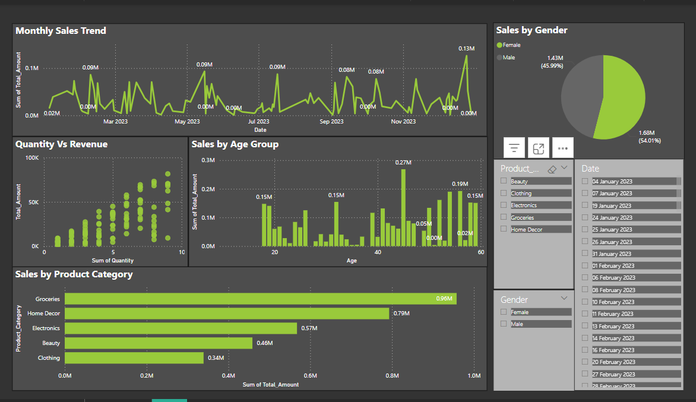
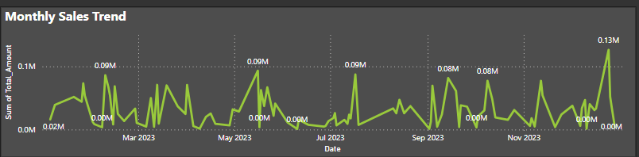
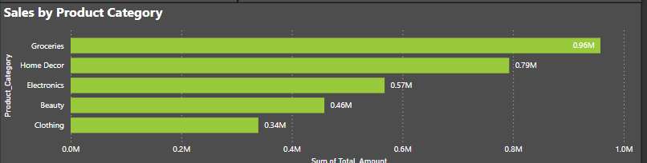
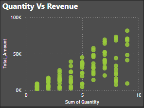

# Retail Sales Performance Dashboard 📊

An interactive **Retail Sales Performance Dashboard** built using **Power BI, SQL Server (SSMS), and Excel** to analyze sales performance, customer behavior, product categories, seasonal trends, and revenue drivers.

The project combines data preparation and transformation in SQL with interactive visualization in Power BI, providing both a high-level business overview and deeper insights into sales performance.

---

## 📌 Project Overview

The goal of this project is to transform raw retail sales data into actionable business insights.

The dashboard focuses on:

- Overall retail sales performance
- Sales trends over time
- Product category performance
- Gender-based purchasing behavior
- Age-based customer contribution
- Quantity versus revenue relationships
- Identification of high-performing and under-performing areas
- Business recommendations for improving revenue and customer engagement

The project workflow can be summarized as:

```text
Raw Retail Data
      ↓
Data Cleaning & Transformation
      ↓
SQL Server / SSMS
      ↓
Power BI Data Model
      ↓
Interactive Dashboard
      ↓
Business Insights & Recommendations
```

---

## 🛠️ Technologies Used

| Technology | Purpose |
|---|---|
| **Microsoft Excel** | Source retail sales dataset and data inspection |
| **SQL Server / SSMS** | Data cleaning, transformation, querying, and preparation |
| **Power BI** | Interactive dashboard development and visualization |
| **Power BI Data Model** | Organizing data for analytical reporting |

---

## 📂 Repository Structure

```text
Retail-Sales-Performance-Dashboard/
│
├── Retail_Sales_Dashboard.pbix
├── Retail_Sales_Data.xlsx
├── SQL_Queries.txt
├── Insights_Document.pdf
├── README.md
│
└── Images/
    ├── Category_Wise_Sales.png
    ├── Main_Dashboard_View.png
    ├── Profit_Margins_Insights.png
    └── Sales_Trends_Analysis.png
```

### File Description

- **`Retail_Sales_Dashboard.pbix`** — Power BI dashboard containing the interactive visualizations and analysis.
- **`Retail_Sales_Data.xlsx`** — Excel dataset used as the source data for the project.
- **`SQL_Queries.txt`** — SQL queries used for data transformation and preparation in SSMS.
- **`Insights_Document.pdf`** — Detailed business insights and actionable recommendations derived from the dashboard.
- **`Images/`** — Dashboard screenshots used to showcase the major analytical views.

---

# 📊 Dashboard Preview

## Main Dashboard View

The main dashboard provides an overall view of retail sales performance and brings the key metrics and visualizations together in a single interactive interface.



---

## 📈 Sales Trends Analysis

The sales trend analysis helps identify changes in sales performance over time and highlights seasonal patterns.

The analysis found that:

- **May and December recorded the highest sales**, indicating a seasonal demand pattern.
- Some months recorded **zero sales**, which should be investigated to determine whether the cause is a data-quality issue, missing records, or an operational downtime.
- Seasonal demand can therefore be used to plan promotional campaigns and revenue-maximization strategies.



### Business Recommendations

- Run stronger promotional campaigns during peak months.
- Prepare inventory and marketing campaigns ahead of seasonal demand.
- Investigate months with zero sales to distinguish between genuine business inactivity and data/operational issues.

---

# 🛍️ Sales by Product Category

Category-level analysis reveals significant differences in revenue contribution across product groups.

According to the analysis:

- **Groceries generated approximately 0.96M** in sales.
- **Home Decor generated approximately 0.79M** in sales.
- These two categories are the strongest contributors to sales.
- **Clothing and Beauty contributed less than 0.5M**, making them relatively weaker-performing categories.



### Business Recommendations

**For high-performing categories:**

- Expand the product range.
- Introduce complementary products.
- Create bundle offers.
- Maintain inventory availability during high-demand periods.

**For lower-performing categories:**

- Experiment with targeted discounts.
- Improve product positioning and promotions.
- Use influencer and category-specific marketing campaigns.
- Analyze customer preferences before expanding inventory.

---

# 👥 Customer Demographic Analysis

Understanding who contributes most to revenue allows marketing strategies to be tailored to specific customer groups.

## Gender-Based Sales Distribution

The dashboard shows that:

- **Female customers account for 54.01% of sales.**
- **Male customers account for 45.99% of sales.**
- Groceries and Home Decor show stronger popularity among female customers.

### Business Recommendations

- Create targeted advertising campaigns around female-dominant categories.
- Develop promotions based on category preferences.
- Introduce additional electronics, fitness, and technology-oriented products to strengthen engagement among male customers.

---

## 🎂 Age-Based Sales Contribution

Age-based analysis indicates that customers between **20 and 40 years old** generate the highest revenue contribution.

The analysis identifies approximately **0.27M at the age-40 peak**.

### Business Recommendations

- Introduce loyalty programs for customers in the 20–40 age group.
- Provide personalized discounts and offers.
- Use targeted campaigns to retain high-value customers.
- Develop tailored promotions to improve engagement among customers below 20 and above 40.

---

# 💰 Quantity vs. Revenue Analysis

One important insight from the dashboard is that **selling a higher quantity does not necessarily result in higher revenue**.

Some products with relatively low sales quantities can contribute significantly to revenue because they are **higher-ticket products**.

This distinction is important because quantity alone is not a sufficient measure of product performance.



### Business Recommendations

- Identify premium and high-margin products.
- Prioritize products that generate strong revenue even at lower quantities.
- Use upselling and cross-selling strategies to increase average order value.
- Evaluate products based on both volume and revenue contribution rather than quantity alone.

<br>

---

# 🔎 Key Business Insights

The analysis highlights several important patterns:

### 1. Seasonal Demand Matters

Sales peak in **May and December**, suggesting that customer demand is affected by seasonal factors.

**Opportunity:** Plan inventory, promotions, and marketing campaigns around these periods.

### 2. A Few Categories Drive a Large Share of Sales

**Groceries and Home Decor** are the strongest-performing categories.

**Opportunity:** Expand successful categories while improving the performance of weaker categories.

### 3. Customer Demographics Can Guide Marketing

Female customers contribute a slightly larger share of sales, while customers between **20 and 40 years old** represent an important revenue-generating segment.

**Opportunity:** Use demographic segmentation to personalize marketing campaigns.

### 4. Revenue Is Not Directly Proportional to Quantity

Some products generate substantial revenue despite having lower sales quantities.

**Opportunity:** Focus on product profitability and revenue contribution, not only unit volume.

### 5. Zero-Sales Periods Require Investigation

Months with zero sales should not automatically be interpreted as genuine low demand.

**Opportunity:** Check source data, business operations, system downtime, and data pipelines to determine the actual cause.

---

# 💡 Actionable Sales Strategy

Based on the analysis, the following strategy can be used to improve overall sales performance:

| Area | Recommended Action |
|---|---|
| **Seasonality** | Run aggressive promotions during May and December |
| **Top Categories** | Expand Groceries and Home Decor offerings |
| **Weak Categories** | Use discounts and targeted marketing for Clothing and Beauty |
| **Female Customers** | Target female-dominant categories with personalized campaigns |
| **Male Customers** | Strengthen electronics, fitness, and technology product offerings |
| **Age 20–40** | Introduce loyalty programs and personalized discounts |
| **Premium Products** | Focus on high-margin and high-ticket products |
| **Average Order Value** | Use upselling and cross-selling |
| **Zero-Sales Months** | Investigate data and operational causes |

<br>

---

# 🎯 Key Takeaways

The project demonstrates how retail data can be transformed into business decisions through a combination of **SQL-based data preparation and Power BI visualization**.

The most important findings are:

- **May and December** are important seasonal sales peaks.
- **Groceries and Home Decor** are the strongest-performing categories.
- **Female customers contribute 54.01% of sales**, compared with 45.99% for males.
- Customers aged **20–40** represent a major revenue-generating segment.
- **High-ticket products** can generate significant revenue even at lower quantities.
- **Zero-sales months** should be investigated for possible data or operational problems.
- Sales growth can be improved through **seasonal promotions, category optimization, demographic targeting, loyalty programs, and upselling**.

<br>

---

#  How to Use the Project

### 1. Open the Power BI Dashboard

Open:

```text
Retail_Sales_Dashboard.pbix
```

using **Microsoft Power BI Desktop**.

### 2. Connect the Dataset

If Power BI requests the source file, connect it to:

```text
Retail_Sales_Data.xlsx
```

### 3. Run the SQL Queries

Open:

```text
SQL_Queries.txt
```

in **SQL Server Management Studio (SSMS)** and execute the relevant queries for data preparation and transformation.

### 4. Explore the Dashboard

Use the Power BI dashboard to explore:

- Sales trends
- Category performance
- Customer demographics
- Revenue contribution
- Product performance
- Profit-margin insights
- Quantity versus revenue relationships

---

# 📸 Dashboard Screenshots

The repository includes four major dashboard views:

| Screenshot | Description |
|---|---|
| `Main_Dashboard_View.png` | Overall dashboard and high-level performance view |
| `Sales_Trends_Analysis.png` | Sales performance and seasonal trends |
| `Category_Wise_Sales.png` | Sales contribution by product category |
| `Profit_Margins_Insights.png` | Revenue/profitability-oriented product insights |

---

# 📌 Project Highlights

### Data Preparation
- Retail sales data handled using Excel and SQL.
- SQL Server / SSMS used for data transformation and analytical queries.

### Dashboard Development
- Interactive Power BI dashboard.
- Multiple analytical views for sales, categories, demographics, and product performance.

### Business Intelligence
- Identified seasonal sales patterns.
- Compared category-level performance.
- Analyzed customer demographics.
- Evaluated quantity versus revenue relationships.
- Converted analytical findings into actionable business recommendations.

---
